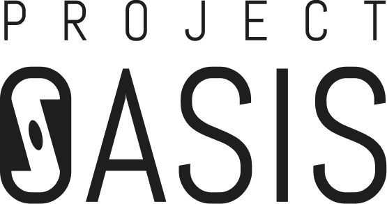
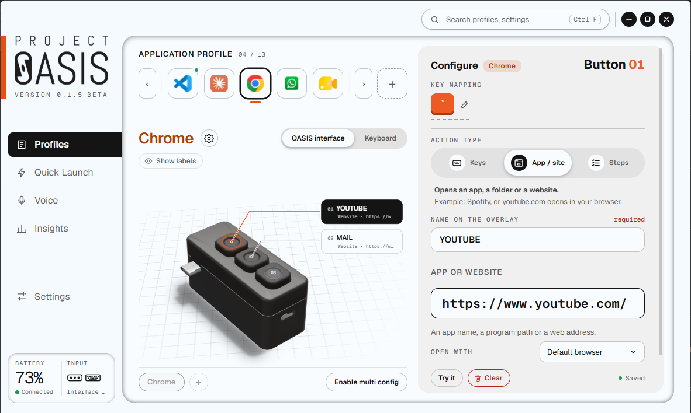
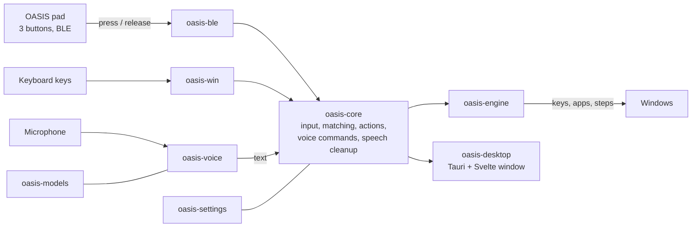

<div align="center">

<picture>
  <source media="(prefers-color-scheme: dark)" srcset="SW/OASIS_LOGO_LIGHT.png">
  
</picture>

### Three buttons. Every app. Your voice.

A small pad with three buttons, and a free Windows app that turns them into whatever the app in front of you needs.

[](https://github.com/dhanushscience/OASIS-releases/releases/latest/download/OASIS-setup.exe)

[](https://github.com/dhanushscience/OASIS-releases/releases/latest)
[](https://github.com/dhanushscience/OASIS-releases/releases)
[](LICENSE)
[](SW/)
[](#status)

[Website](https://dhanushscience.github.io/PROJECT-OASIS/) · [Install guide](beta/INSTALL.md) · [User guide](beta/USING.md) · [Report a bug](beta/FEEDBACK.md) · [Changelog](CHANGELOG.md)

<picture>
  <source media="(prefers-color-scheme: dark)" srcset="assets/oasis-dark.png">
  
</picture>

<sub>The app follows your Windows theme. Light and dark are both first-class.</sub>

</div>

---

## Why it exists

A keyboard shortcut means one thing in VS Code and another in YouTube. A pad with fixed keys cannot keep up. OASIS watches which app is in front and gives each of the three buttons a meaning for **that app**. Then it adds the part a pad cannot do alone: you hold a button and talk.

| You press | Default profile | Chrome profile | Hold it in any text box |
|---|---|---|---|
| **Button 1** | Open VS Code | Open YouTube | Voice typing: your words are typed and tidied |
| **Button 2** | Yours to set | Open Mail | Voice command: "open Spotify", "new tab" |
| **Button 3** | Open Claude | Yours to set | Whatever you set |

> These are the profiles in the screenshot above. Every button, in every app, is yours to set.

## What is inside

- **Profiles per app.** One profile for each program, switched for you. A button can paste keys, open an app or page, or run a short series of steps.
- **Voice that stays on your PC.** Speech is recognised locally. The model that fits your PC is downloaded on first start. Online speech-to-text (Groq) is optional, uses your own key and is off until you turn it on.
- **Self-correcting dictation.** Say "my name is Dhanush", and a slip like "danush" is fixed as it is typed, by cleanup rules and, on PCs that use it, a small OASIS fine-tuned polish model.
- **Voice commands.** "Open Notes", "open a new window in Chrome", "new tab". Phrases are matched fuzzily, so close is good enough.
- **Quick Launch.** Open a set of apps and put each one where you want it across your screens, in one go.
- **The overlay.** Three faint bars at the screen edge always show what each button does right now.
- **Insights.** Optional, local history of what you dictated, with the audio, so you can see where it went wrong. Never uploaded.
- **No pad yet?** The three buttons work from your keyboard.

## Get it

1. **[Download the installer](https://github.com/dhanushscience/OASIS-releases/releases/latest/download/OASIS-setup.exe)** (about 11 MB).
2. Run it. Windows 10 or 11, 64-bit. A guide (Mr. Science) walks you through the first minutes.
3. Hold a button and talk.

Updates arrive inside the app. Full steps: [beta/INSTALL.md](beta/INSTALL.md).

## How it is built



The brain, `oasis-core`, has no operating-system code in it, so it is tested without a pad or a screen. Everything that touches Windows, Bluetooth or the microphone sits in a thin crate around it. Details in [SW/README.md](SW/README.md).

| Part | Where |
|---|---|
| Rust workspace (11 crates) | [`SW/crates/`](SW/crates) |
| Desktop app (Tauri + Svelte) | [`SW/apps/oasis-desktop/`](SW/apps/oasis-desktop) |
| Browser extension (off in this beta) | [`SW/extensions/`](SW/extensions) |
| Tester guides and release notes | [`beta/`](beta) |
| Website | [`webpage` branch](../../tree/webpage) |
| Installers and update feed | [OASIS-releases](https://github.com/dhanushscience/OASIS-releases/releases) |

### Build from source

You need stable Rust, Node 20+ and the WebView2 runtime. See [CONTRIBUTING.md](CONTRIBUTING.md) and [SW/scripts/README.md](SW/scripts/README.md).

```powershell
cd SW/apps/oasis-desktop/web
npm install; npm test; npm run build
cd ../../..
cargo build --release -p oasis-desktop
```

## Status

OASIS is in **public beta**. It works and real people use it, so expect rough edges.

- [x] Pad, profiles, overlay, Quick Launch
- [x] Local voice typing and voice commands
- [x] Self-updating installer
- [ ] Calendar, Spotify and the browser extension (switched off, "Coming soon", still being tested)
- [ ] Moving releases into this repository

## Contributing

Bug reports are the most useful thing right now: [beta/FEEDBACK.md](beta/FEEDBACK.md) says what to include. Code changes are welcome too, read [CONTRIBUTING.md](CONTRIBUTING.md) first. Security issues go through [SECURITY.md](SECURITY.md).

## Licence

[Apache-2.0](LICENSE). The speech and polish models are downloaded separately and keep their own licences (see the release notes). Made by [Dhanush Science](https://github.com/dhanushscience).
